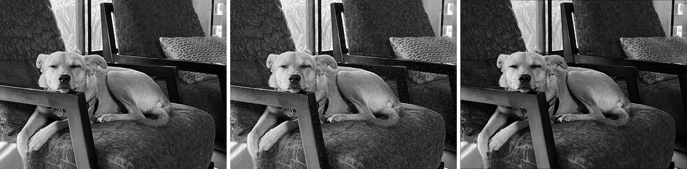
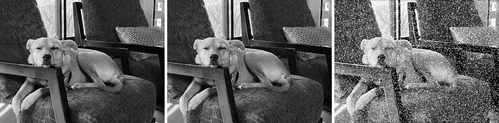
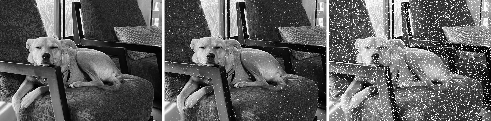

# Tasks 10.9–10.12: morphology on the DSP

Source instructions: Lab3_F26 (1).pdf, Task 10 Part D, pages 18–19.

## Setup and measurement method

Measured on the connected SM8850P board using the lab container and Hexagon SDK 6.7.0.1. The provisioned ARM conv_morph binary was outdated and silently produced a synthetic 1024×1024 circle, even when passed --input. Rebuilt the supplied, unchanged ARM client source; verified the 1024×768 dog input in every retained raw record. The final client was also rebuilt with the instructor's exact `bash kernels/convolution/dsp/build_stub.sh` command after `chmod +x tools/android-clang` and conversion of that wrapper's Windows CRLF line endings to LF inside the container. Only conv_morph from that client build was pushed. The student DSP library was built/pushed with `bash scripts/build_student.sh morph`.

All retained runs explicitly pass input=dog.pgm, damage=salt (default), seed=42 (default), and iterations=1. Each case has six independent profiler dispatches, alternating student and QHL serially, with 0.25 s between pairs and 2 s between groups. Times are DSP-native `dsp_us`, not host/FastRPC wall time. CoV is sample standard deviation divided by mean, multiplied by 100. Speedup is student mean / QHL mean. Raw measurements and complete client output are in measurements.csv and raw.jsonl. No clock pinning was added. Preliminary synthetic-image timings were excluded.

## 10.9: choose the operator

The damaged dog image contains isolated bright (salt) specks. Erosion takes the local minimum, replacing most isolated bright outliers with darker neighboring values. It also shrinks bright structures and darkens edges, so it is not a perfect reconstruction of the original. Dilation takes the local maximum and spreads each bright speck into neighboring pixels, visibly worsening the noise.

For K=3, QHL erosion leaves **9,182 residual pixels**, while QHL dilation leaves **102,830**, about 11.2 times more. Every repeat returns these same residuals. Residual counts differences from the same operator applied to the clean image, over the interior; it is not a count of differences directly from the unfiltered clean image.





## 10.10: implementation and validation

Implemented morph_scalar in kernels/lab3/morph/student_morph.c with the requested nested loops. Each output pixel examines the centered K×K neighborhood, using minimum for erosion and maximum for dilation. Out-of-image neighbors are skipped (clipped neighborhood); every output pixel is assigned. The QHL code and DSP entry point were preserved.

The student K=3 residuals are **9,182 for erosion** and **102,830 for dilation**, matching QHL. Saved repaired PNGs also match QHL pixel-for-pixel over the K=3 interior for both operators. Full-image fingerprints differ because QHL uses its own border policy; the handout explicitly compares interiors. Across all 72 retained dispatches, student/QHL residuals match for both operators at K=3, 5, and 7.




## 10.11: timing and speedup

The requested six erosion times are the means below (six repetitions each).

| K | Student mean (us) | Student CoV | QHL mean (us) | QHL CoV | QHL speedup | QHL effective GB/s |
|---|---:|---:|---:|---:|---:|---:|
| 3 | 49678.67 | 0.72% | 124.33 | 1.74% | 399.56x | 12.65 |
| 5 | 120558.50 | 0.63% | 133.33 | 1.13% | 904.19x | 11.80 |
| 7 | 194950.83 | 0.03% | 146.50 | 1.54% | 1330.72x | 10.74 |

Supplemental dilation validation/timing:

| K | Student mean (us), CoV | QHL mean (us), CoV | Speedup | Residual (both) |
|---|---:|---:|---:|---:|
| 3 | 65300.00, 0.53% | 124.17, 1.56% | 525.91x | 102830 |
| 5 | 131804.83, 0.88% | 134.50, 1.74% | 979.96x | 252521 |
| 7 | 215798.17, 0.41% | 144.83, 2.29% | 1489.98x | 415656 |

## 10.12: scaling and bottleneck

The scalar erosion time grows from 49678.67 us at K=3 to 194950.83 us at K=7, a 3.92x increase. Its nested loops perform approximately W×H×K² neighborhood visits; K² grows from 9 to 49 (5.44x). Observed time need not grow by exactly 5.44x because loop overhead, branch behavior, compilation, and edge clipping also contribute. QHL grows only from 124.33 to 146.50 us (1.18x), so it avoids the scalar implementation's expensive per-pixel scalar neighborhood processing. HVX handles 128 byte lanes per 1024-bit vector. Efficient reuse of overlapping neighborhoods and vector min/max can greatly reduce instruction and load overhead; these measurements do not identify QHL's exact internal algorithm.

The handout's minimum read-plus-write traffic is 2×1024×768 = **1,572,864 bytes** per call. Effective bandwidth is B/(time_us×1000) GB/s: **12.65 GB/s** at K=3, **11.80 GB/s** at K=5, and **10.74 GB/s** at K=7. Traffic stays roughly fixed while QHL time changes little despite the larger window. This supports the lab's interpretation that QHL is primarily limited by moving image data through the memory/cache and vector load/store path, whereas the scalar version is dominated by neighborhood processing. These are effective bandwidths based on minimum useful traffic, not measured DRAM bandwidth or proof that external DDR alone is saturated.

The DSP timer surrounds only morph_qhl: aligned-buffer allocation, host-to-aligned input memcpy, output memcpy, HVX lock/unlock, FastRPC, and image saving are outside that timed region. Thus these speedups describe filter execution, not end-to-end application latency.

## Reproduction

Inside the container:

```bash
chmod +x tools/android-clang
bash kernels/convolution/dsp/build_stub.sh
adb push kernels/convolution/dsp/prebuilt/conv_morph /data/local/tmp/profiler-kernels/dsp/
bash scripts/build_student.sh morph
PYTHONPATH=/workspace python scripts/measure_task10_morph.py
python profiler.py morph dsp -p input=dog.pgm -p impl=qhl -p op=erode -p write_pgm=true
python profiler.py morph dsp -p input=dog.pgm -p impl=qhl -p op=dilate -p write_pgm=true
python profiler.py morph dsp -p input=dog.pgm -p op=erode -p write_pgm=true
python profiler.py morph dsp -p input=dog.pgm -p op=dilate -p write_pgm=true
```

If the container hostname connection fails, use its currently verified IPv4 host address for that shell: `export ANDROID_ADB_SERVER_ADDRESS=192.168.65.254`. This address is specific to this Docker setup. From laptop PowerShell, `docker cp lab3:/workspace/morph_images .` copies images out.

Built DSP library SHA-256 (also verified on board): 216fb20b24c327de30e88e6699d4b0988bfe37388ff3647a0d7fe4059f92a984.
