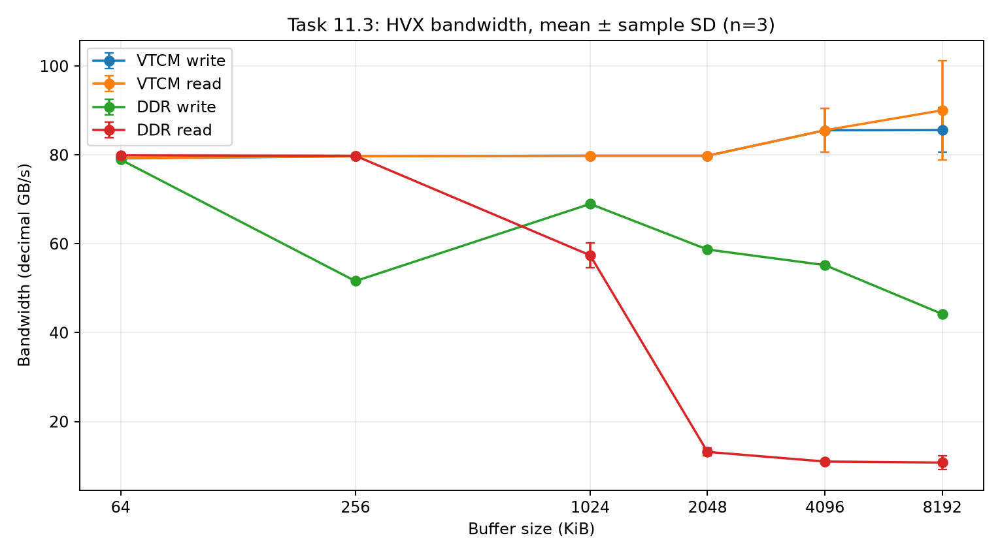

# Task 11: Move the Data Yourself

Instructions: Lab3_F26 (1).pdf, pages 19–20, Tasks 11.1–11.10.

## Setup, scope, and reproducibility

Measurements were collected on the connected SM8850P board from the lab3 container, with Hexagon SDK 6.7.0.1 and v81 compilation. The supplied updated conv_stage and conv_vtcm_probe clients were pushed from the container's existing build. The initial provisioned probe printed extra reference sections by default; all retained probe data below comes from the updated client's sections 1–4 only. No reference DSP sources, DDR implementation, naive implementation, or stage_kernel were edited. The code change is kernels/lab3/vtcm/student_vtcm.c. The shared DSP library also retains the completed student_morph.c implementation from Task 10.

Three independent dispatches per case; CSV and raw JSONL were flushed after each result. Data size is the harness's 32 MiB (33,554,432 bytes), with sixteen 2 MiB blocks. The final implementation allocates only the provided 4 MiB VTCM grant, split into two 2 MiB buffers, below the board's 8 MiB capacity. P is passes per block. Results use DSP-native time, including exposed copy and compute, not host wall time. Tables show mean (sample CoV %), n=3. summary.csv also reports min/max and CoV for every timing component. Hardware clocks were not modified beyond the supplied clients' behavior: the probe requests its default lab power mode; the stage client does not explicitly request that mode, so cross-client bandwidth comparisons describe observed paths rather than an exactly frequency-matched hardware ceiling.

The installed DMA API constrains descriptor width/height/stride to 16 bits. Therefore each 2 MiB transfer uses a 2D descriptor with 64 rows, width/stride 32,768 bytes, source cache bypass, and VTCM destination. A naive 2 MiB 1D descriptor would exceed the API limit. Descriptor setup/submission errors return a failure, never a memcpy fallback. Each descriptor remains valid until DMA completion. Cache cleaning is enabled in the final code. Experimental source snapshots are in versions/; the intentionally incorrect no-clean variant is not the final source.

## 11.1: capacity

All three probes report one page of 8,388,608 bytes: **8 MiB**. A single 8 MiB acquire succeeds; 8 MiB + 1 byte, 8 MiB + 4096 bytes, 12 MiB, and 16 MiB fail. Two concurrent 4 MiB acquires both succeed, reaching the same 8 MiB total. For two 5 MiB requests, the first succeeds and the second fails. Thus the advertised capacity holds for the tested allocations. Complete acquisition results and times are in probe_1.txt through probe_3.txt.

## 11.2: VTCM bandwidth and timing

Section 4 results follow. The columns are mean GB/s (sample CoV %) from the probe's printed values, rounded by that client to 0.1 GB/s.

| Buffer (KiB) | VTCM write | VTCM read | Ordinary write | Ordinary read |
|---|---:|---:|---:|---:|
| 64 | 79.20 (0.00%) | 79.30 (0.00%) | 78.93 (0.07%) | 79.90 (0.00%) |
| 256 | 79.70 (0.00%) | 79.70 (0.00%) | 51.60 (0.00%) | 79.80 (0.00%) |
| 1024 | 79.80 (0.00%) | 79.80 (0.00%) | 68.97 (0.44%) | 57.40 (4.99%) |
| 2048 | 79.80 (0.00%) | 79.80 (0.00%) | 58.70 (0.17%) | 13.17 (7.06%) |
| 4096 | 85.53 (5.81%) | 85.53 (5.81%) | 55.20 (0.48%) | 11.00 (1.57%) |
| 8192 | 85.57 (5.84%) | 90.03 (12.37%) | 44.20 (0.39%) | 10.77 (14.75%) |

In dsp_conv_vtcm_probe.c, modes 3/4 acquire VTCM, lock HVX, and perform an untimed write to populate the buffer. The timer then surrounds only bw_write or bw_read for `iters` passes; acquisition, HVX locking, initialization, unlock, and release are excluded. Each size moves 268,435,456 bytes in the timed direction: iters = 268435456 / size. The same loops operate on aligned ordinary memory in modes 5/6. Bandwidth is size × iters / elapsed time.

bw_read uses four independent HVX accumulators, combines their vector sums, reduces to a scalar, and returns it through the probe output. The observable checksum prevents dead-load elimination; four accumulators also reduce the dependency-chain bottleneck of a single running sum. Writes issue 128-byte vector stores. These are warmed-buffer microbenchmarks, not uncached DRAM-only measurements.

## 11.3: cache transition



Ordinary read bandwidth is high at 64/256 KiB, falls at 1 MiB, and drops sharply at 2 MiB to roughly 14 GB/s; 4/8 MiB remain around 11–13 GB/s. This brackets the effective cache-resident working set near the 1 MiB scale and indicates that 2 MiB no longer fits effectively. The sweep does not determine an exact architectural cache capacity or associativity. VTCM does not show this cache-capacity collapse because the allocation remains in its explicit scratchpad. Ordinary write figures differ from reads because stores, buffering, and cache behavior differ.

## 11.4: convolution weights

Weight bytes = 36 C² for K=3 and float32 weights.

| C | Bytes | KiB | MiB |
|---|---:|---:|---:|
| 64 | 147,456 | 144 | 0.140625 |
| 128 | 589,824 | 576 | 0.5625 |
| 256 | 2,359,296 | 2304 | 2.25 |

C=64 and C=128 weights are below the observed read-bandwidth cliff and may already be served well by cache, though activations and other working data can compete with them. C=256 weights exceed that effective cache range, so repeatedly reusing them from VTCM is more likely to repay the initial copy and avoid repeated cache misses. All three sizes fit the measured VTCM capacity in isolation. Benefit depends on reuse and the rest of the working set, not size alone.

## 11.5–11.7: serial-copy experiments, P=1

The baselines below are the initially measured supplied DDR/naive paths. The remaining rows use the student staged path.

| Version | Total us (CoV) | Copy us (CoV) | Compute us (CoV) | Copy GB/s | Checksum |
|---|---:|---:|---:|---:|---|
| baseline / ddr | 6552.3 (0.70%) | 0.0 (0.00%) | 6543.3 (0.69%) | 0.00 | 2097104 |
| baseline / naive | 67274.3 (0.50%) | 65747.0 (0.51%) | 1512.7 (0.15%) | 0.51 | 2097104 |
| hvx / staged | 5158.3 (0.31%) | 3440.0 (0.48%) | 1691.0 (0.12%) | 9.75 | 2097104 |
| dma_serial / staged | 3262.3 (0.29%) | 1557.0 (0.55%) | 1686.0 (0.06%) | 21.55 | 2097104 |
| dma_no_clean / staged | 2421.7 (0.33%) | 718.0 (1.14%) | 1684.7 (0.03%) | 46.73 | 2085652,2086036,2086056 |

**11.5.** Direct DDR has no explicit copy. Naive staging spends almost all its time in memcpy; its roughly 0.51 GB/s payload copy rate is far below both the ordinary-memory HVX read rate and VTCM bandwidth. This shows that the memcpy path is the bottleneck, not VTCM's inherent storage speed. Payload copy bandwidth counts bytes copied once, whereas the probe times one read or write direction; actual copying also performs destination writes.

**11.6.** my_copy now loads/stores HVX_Vector values (128 bytes per vector) and handles a byte tail. HVX staged total is 5158.3 us versus DDR 6552.3 us, a 1.27x speedup. Even with no reuse it benefits from the faster VTCM compute path, although the serial HVX copy still adds several milliseconds.

**11.7.** Coherent serial DMA total is 3262.3 us; its transfer uses the DMA engine with source-cache cleaning, followed by wait-for-idle before compute. Removing cleaning reduces apparent copy/total time but returns incorrect, changing checksums instead of the correct P=1 value 2,097,104. Dirty source cache lines have not necessarily reached the backing memory read by cache-bypassing DMA. The explicitly requested `--repeat 3` run is saved in dma_no_clean_repeat3.txt; it reports distinct fingerprints and therefore cannot be accepted as a speedup. Cleaning was restored before the final builds.

## 11.8: double-buffered DMA sweep

The next transfer targets the other buffer and is submitted before computing the current buffer. DMA completion is awaited before that destination becomes the next input. The first block is copied and awaited before entering the pipeline. copy_us counts the initial transfer, source cache cleaning/descriptor submission, and exposed completion waits; it does not count background transfer time twice. compute_us is elapsed time around stage_kernel. Bookkeeping and HVX lock/unlock account for the small difference between total and copy+compute.

All three implementations below have identical checksums for a given P in all three repetitions. Serial DMA (11.7's algorithm) was additionally measured at every P, allowing a direct same-P overlap comparison.

| P | DDR total us (CoV) | DDR copy us | Naive total us (CoV) | Staged total us (CoV) | Staged copy us (CoV) | Staged compute us (CoV) | Serial DMA total us | Serial copy us | DDR/staged |
|---|---:|---:|---:|---:|---:|---:|---:|---:|---:|
| 1 | 6567.3 (0.05%) | 0 | 66593.0 (1.31%) | 2602.7 (0.04%) | 893.7 (0.13%) | 1685.3 (0.09%) | 3262.3 | 1557.0 | 2.52x |
| 2 | 12179.3 (0.13%) | 0 | 67076.3 (1.60%) | 4284.0 (0.06%) | 895.3 (0.50%) | 3366.3 (0.05%) | 4928.7 | 1546.0 | 2.84x |
| 4 | 22657.7 (1.08%) | 0 | 70605.3 (0.66%) | 7644.7 (0.02%) | 896.0 (0.00%) | 6726.7 (0.01%) | 8295.0 | 1551.3 | 2.96x |
| 8 | 39340.0 (6.74%) | 0 | 76402.7 (1.86%) | 13832.3 (0.44%) | 870.0 (0.64%) | 12939.7 (0.43%) | 14476.7 | 1518.3 | 2.84x |
| 16 | 75027.0 (1.41%) | 0 | 86841.7 (1.08%) | 26000.3 (0.04%) | 849.3 (0.18%) | 25126.7 (0.05%) | 26640.0 | 1496.7 | 2.89x |

Exposed-copy reduction relative to the serial algorithm (an operational estimate, since these are separate runs):

| P | Copy time removed (us) | Serial copy fraction removed | Total time saved (us) |
|---|---:|---:|---:|
| 1 | 663.3 | 42.6% | 659.7 |
| 2 | 650.7 | 42.1% | 644.7 |
| 4 | 655.3 | 42.2% | 650.3 |
| 8 | 648.3 | 42.7% | 644.3 |
| 16 | 647.3 | 43.3% | 639.7 |

Not all copy costs disappear. The first transfer has no preceding computation to hide behind, source-cache cleaning and submission run on the DSP thread before computing, and any DMA longer than the concurrent compute leaves an exposed wait. For the last block there is no following transfer to overlap; its computation still has to complete. Increasing P gives DMA more computation to hide behind, but it cannot hide serial setup/cleaning or pipeline startup. Ratios and reductions here are based on means, not an assertion that the separately measured serial and overlapping transfers have identical instantaneous bandwidth.

## 11.9: why staging wins at P=1

At P=1, DDR total is 6567.3 us, whereas overlapped staging takes 2602.7 us (2.52x faster). DDR compute itself takes 6557.3 us; VTCM compute takes 1685.3 us, with only 893.7 us of exposed copy cost. This gain does not require reusing each block: DMA streams the source into VTCM while HVX consumes a different block, and VTCM feeds the vector compute faster than direct ordinary-memory accesses. The saved compute/memory-stall time exceeds the remaining copy cost. The naive memcpy version demonstrates why merely placing data in VTCM is insufficient.

## 11.10: corresponding CPU mechanisms

VTCM performs explicit placement like a CPU cache; DMA plus pipelining performs explicit data movement ahead of use like a hardware prefetcher/cache-fill machinery. Manual control gives predictable residency, avoids unwanted cache eviction, controls transfer size and timing, and can overlap memory movement with useful work. Its costs are limited scratchpad space, extra copies and startup, explicit coherence and synchronization, more complex code, and workload-specific tuning. Hardware caches/prefetchers adapt automatically and preserve the ordinary coherent load/store abstraction, but provide less direct control over residency and movement.

## Validation and reproduction

The correct baseline, HVX, serial-DMA, and final-overlap datasets all match the DDR checksum at the same P; 69 correct dispatches were checked. The three additional no-clean dispatches intentionally fail correctness, as do the separate requested CLI repeat run. Raw output, component timings, variants, and probe logs are retained. No checksum comparison assumes linearity in P: float accumulation/rounding can make that assumption invalid at large P.

Final coherent/overlapped code is in kernels/lab3/vtcm/student_vtcm.c with COPY_MODE=2, DMA_CLEAN=1, OVERLAP=1. Preserve Task 10 in the shared library by building inside the container with:

```bash
bash scripts/build_student.sh vtcm --exclude dsp_conv_morph_imp.c --add /workspace/kernels/lab3/morph/student_morph.c
PYTHONPATH=/workspace python scripts/measure_task11.py probe --probe
PYTHONPATH=/workspace python scripts/measure_task11.py dma_overlap --impls ddr,naive,staged --passes 1,2,4,8,16
```

The supplied script regenerates incremental CSV/JSONL; use a new label to retain previous results. For serial/HVX/no-clean experiments, copy the corresponding versions/*.c snapshot into the container's student_vtcm.c, rebuild using the same command, then invoke the runner with that variant's label. Always restore the final coherent source afterwards. Results/plots can be regenerated on the laptop with `python scripts/report_task11.py` (matplotlib required for the plot).

The measured final DSP library SHA-256, verified equal on the board and in the container, is 342084babf775373fd5b89cfb7774af5f1651c5a845ea766f79558d3e5dad16d. Afterwards only explanatory comments in student_vtcm.c were cleaned up; executable statements are unchanged. SDK/reference files were read only. Existing generated client/build outputs in the container were rebuilt as needed; source changes on the laptop are limited to the Task 11 student file and the previously completed Task 10 file, plus new measurement/report scripts and results.
